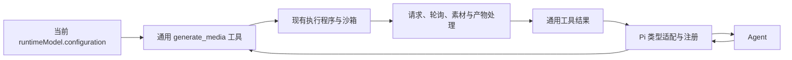

# 媒体生成工具

Agent 使用通用内置 `generate_media` 工具查询当前选中模型的用途并生成媒体。完整配置随 `runtimeModel.configuration` 传入，工具不会读取其他模型或切换模型。工具定义与完整流程位于 Runtime 通用 `tools` 中，不依赖 Pi 的类型或 Server 的媒体业务服务。桌面和应用内的共享 Chat 界面展示生成结果，不使用或修改 Pi 源码。



## 使用方式

先查询当前模型的媒体用途及输入要求：

```json
{ "action": "list", "purpose": "image-generation" }
```

返回当前 `modelId` 和 `purposes` 列表，每项包含用途、输入输出类型、`inputSchema` 和可覆盖参数。Key、连接地址和请求模板不进入模型上下文。

支持 `image-generation`、`image-editing`、`video-generation`。只列出当前模型已配置请求与响应规则的 HTTP / JSON 用途；没有可执行的媒体用途、没有完整配置或已禁用工具调用时，不注册媒体工具。不会按模型名称猜测接口，也不会借用其他已配置模型的能力。

按返回的结构执行：

```json
{
  "action": "generate",
  "purpose": "image-generation",
  "input": { "prompt": "画一只猫" },
  "parameters": { "aspect_ratio": "16:9" },
  "outputDirectory": "generated-media"
}
```

`prompt`、`aspect_ratio` 只是示例，字段由选定用途的 Schema 和参数定义决定。未传参数沿用配置默认值，不可覆盖的参数在提交前拒绝。通用工具校验 `runtimeModel.configuration`，使用选定用途的 `connection` 和 `modelId`。设置桥接层提交前解析每个用途对 Provider 和顶部模型 ID 的继承；独立连接的空 Key 不回退到对话 Key。直接提交运行时参数时，缺省的用途连接和模型 ID 沿用同一 `runtimeModel`。本轮内快照稳定，设置变更在下一轮生效。需要组合不同服务时，在当前模型的用途中配置独立连接和请求模型 ID，运行时不再查找其他模型。

可选 `files` 将本地文件填入任意 JSON 输入字段，随后执行输入校验：

```json
{
  "action": "generate",
  "purpose": "image-editing",
  "input": { "prompt": "改成水彩风格", "images": [null] },
  "files": [
    {
      "pointer": "/images/0",
      "filePath": "/完整工作区路径/reference.png",
      "format": "data-url"
    }
  ]
}
```

父级对象和数组由 `input` 提供。`format` 可选 `data-url` 或 `base64`，默认前者；无法识别格式时指定 `mimeType`。最多 8 个本地文件，每个 16 MiB，须位于当前工作区并获得 Agent 的读取权限。供应商要求 multipart 或先上传取得素材 ID 的流程尚未接入。

## 执行与结果

请求复用 `buildModelRequest` 和 `parseModelResponse`。直返接口读取最终结果；任务接口提取 ID、等待并查询状态，直到成功或失败。所有步骤由通用工具维护，不需要 Agent 或 Server 反复查询。

URL 产物流式下载，Base64 产物解码后保存；大文件不进入工具 IPC 或聊天记录。默认保存到当前工作区的 `generated-media`，也可指定工作区内的其他目录。文件名自动生成 UUID，临时文件写入完成后提交，不覆盖已有文件。图片上限 64 MiB，视频上限 2 GiB，JSON 响应上限 64 MiB。CDN 下载不附带 Provider 凭据，跨域跳转不转发请求头；生成提交发生重定向时拒绝重放。

结果包含 `status`（`completed`、`failed` 或 `stopped`）、当前 `modelId`、用途、可用的上游任务 ID，以及 `outputs`。文件产物返回绝对 `filePath`、类型、MIME 和大小；附加文本或 JSON 单项最多 32 KiB。失败时返回阶段和错误说明，保留已保存产物并清理未完成文件。

结果沿现有工具链路进入本轮会话，Agent 可引用文件或继续处理。返回路径不代表模型已看过图片或视频；检查内容仍需对应的读取或分析能力。

共享 Chat 在工具过程之外展示媒体结果：图片可点击放大预览，视频提供播放控件，文件卡片支持复制路径，并通过宿主预览弹窗打开原文件。关闭「工具调用过程」不会隐藏生成产物。运行中展示进度说明；失败、停止时保留已保存文件，不提供自动重新提交生成请求的操作。

会话单独保存文件路径、类型、大小和执行状态，不依赖被截断的工具日志。历史会话恢复后重新申请只读预览，不保存临时资源地址或文件数据。预览复用 SDK 文件服务及渲染器，进入可见区域时申请、离开或卸载时释放；文件缺失或权限不足时显示错误，重试仅重新加载预览。

## 权限与生命周期

宿主沿现有请求链路传递当前选中模型的配置；Server 仅补充受保护路径，不读取其他模型。配置不会传给应用执行 worker 或模型；每次生成只把当前配置交给独立的通用媒体执行程序。没有专用媒体 HTTP 接口、临时媒体 Token 或 Server 媒体会话管理。

调用经过 Runtime 现有安全分析与审批，生成目录写入和本地素材读取提供给安全规则。实际 I/O 通过现有 `ProgramExecutor` 执行，使用同一份执行策略与沙箱。通用工具还检查当前工作区、受保护路径、符号链接、Agent 的文件与网络权限；复用已有访问判断，不在 Server 另写一套媒体权限。

同一任务的同一工具调用 ID 只执行一次，生成 POST 不自动重试。去重不跨任务或重启，也不能阻止 Agent 使用新调用 ID 重新生成；工具说明要求失败或停止后不要自动重新提交付费请求。

默认总等待 1800 秒，可通过 `timeoutSeconds` 在 1–3600 秒内调整。通用工具的等待状态更新保持 Agent 活动检测，不伪造供应商进度。取消调用会通过现有执行程序中止请求、轮询和下载，不能保证供应商已取消任务；保留已知任务 ID。当前不提供持久化队列、崩溃恢复、后台唤醒或自动续聊。

## 代码组织与参考

通用入口位于 `apps/agent-runtime/src/engines/drivers/native/agent/tools/media/index.ts`，定义参数、目录查询与工具生命周期。媒体工具的实现集中在 `media/` 目录：`generate.ts` 编排生成，`request.ts` 构造请求并轮询，`files.ts` 处理素材与产物，`permissions.ts` 复用 Runtime 访问规则，`worker.ts` 接入通用执行器。

Pi 的 `runtimes/pi/tools/media-tool.ts` 只使用 `toPiToolParameters` 转换参数，将 Pi 的取消、进度和结果类型适配到通用工具。Server 不维护媒体模型目录或生成流程。其他引擎可以直接调用 `createMediaTool`，没有可用媒体用途时返回 `undefined`，不依赖 Pi。

参考调研日期：2026-10-14。

- [Pi 官方历史图片工具扩展](https://github.com/badlogic/pi-mono/blob/27b27d94412b33e527c3c6777fd60a2c36f7afc3/packages/coding-agent/examples/extensions/antigravity-image-gen.ts)：普通工具注册、等待、取消和返回结果。
- [image-generation-mcp](https://github.com/farukcan/image-generation-mcp/blob/main/src/image_generation_mcp/server.py)：生成并保存文件，返回路径。
- [Open WebUI 内置工具](https://github.com/open-webui/open-webui/blob/main/backend/open_webui/tools/builtin.py)：在当前工具调用中等待并返回生成结果。
- [FAL MCP Server](https://github.com/mgd1984/fal-mcp-server/blob/main/main.py)：视频任务的提交、查询与取消工具。本实现将查询留在工具内部。
